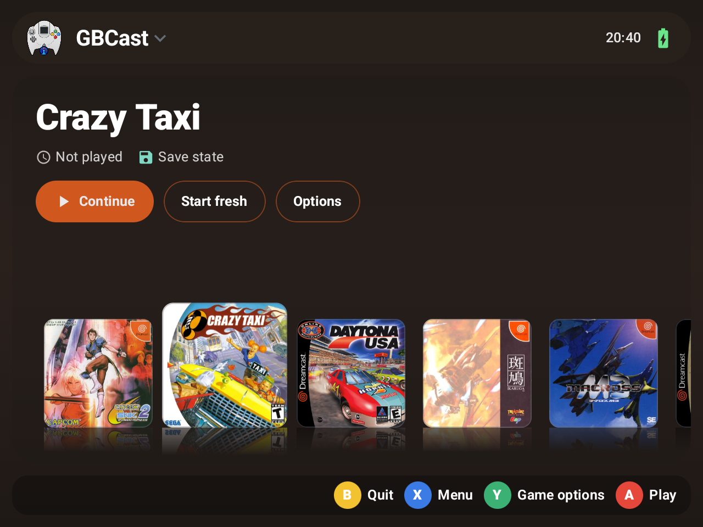
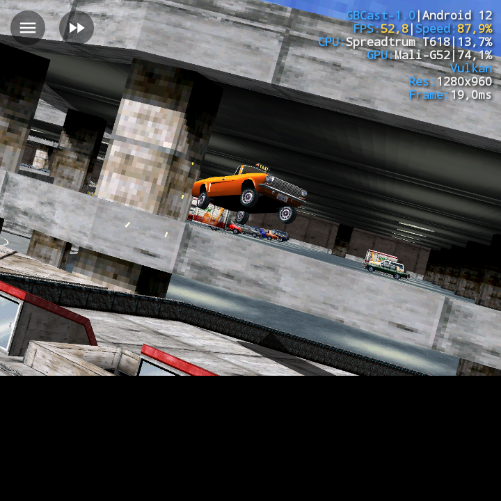
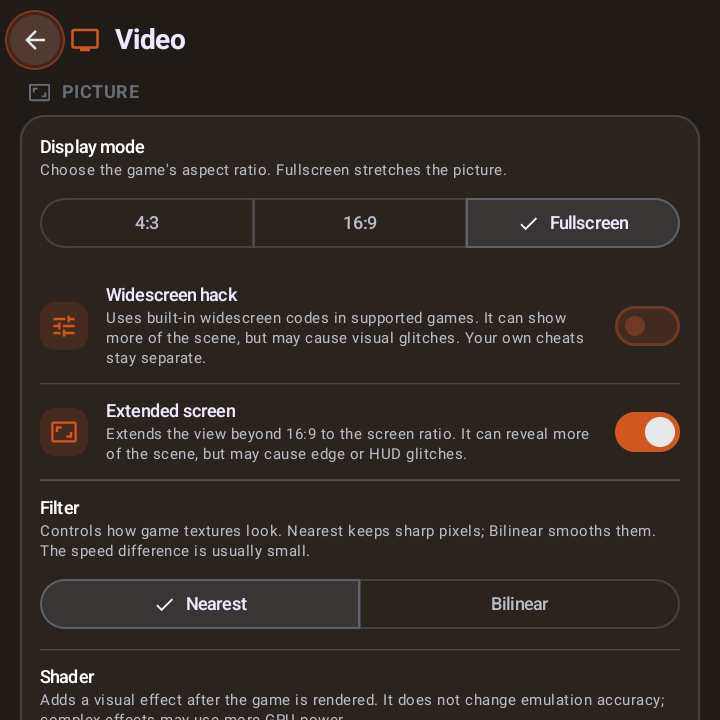

<div align="center">

# GBCast

**Sega Dreamcast and compatible arcade emulation for Android phones and handhelds**

Flycast core · GLES and Vulkan · Save states · RetroAchievements

[Download the latest APK](https://github.com/mindspotgb/GBCast/releases/latest) · [Changelog](CHANGELOG.md) · [Privacy policy](PRIVACY.md)



</div>

GBCast is an Android emulator built around the [Flycast](https://github.com/flyinghead/flycast) core and the shared [GBFrame](https://github.com/mindspotgb/GBFrame) app framework. This repository contains the Android app, its Flycast source revision, and the dependencies used for the Android build.

## Highlights

| | |
| --- | --- |
| 🕹️ **Dreamcast and arcade systems** | Flycast supports Dreamcast, Naomi, Naomi 2, and Atomiswave software |
| 🚀 **Graphics options** | GLES and Vulkan renderers, enhanced resolution, shaders, and texture filtering |
| 🎮 **Built for handhelds** | Controller navigation and remapping, touch controls, and an in-game quick menu |
| 💾 **Save states** | Automatic and manual states, screenshots, resume support, and save-data folder workflows |
| 🏆 **RetroAchievements and cheats** | Optional RetroAchievements support and per-game cheats |
| 🖼️ **Game library** | Game covers, play time, and Showcase, Grid, and All in One layouts |
| ⚙️ **Per-game settings** | Device-aware recommended profiles and configurable video, audio, and performance options |

## Screenshots

Screenshots below were captured from the current GBCast Android build. The library shows real game titles and their covers.

<p align="center">
  
  
</p>

## All features

- **Emulation:** Flycast-based support for Dreamcast, Naomi, Naomi 2, and Atomiswave software; required firmware and game images are supplied by the user.
- **Video:** GLES and Vulkan renderers, enhanced internal resolution, supported display modes and widescreen hacks, shaders, and texture filtering.
- **Audio and performance:** Audio settings, fast-forward, frame pacing and frame skip options, and device-aware per-game profiles.
- **Input:** Physical controller support and button remapping, Dreamcast touch controls with configurable haptics, hotkeys, and an in-game quick menu.
- **Saves and library:** Automatic and manual save states, resume support, game covers, play time, and Showcase, Grid, and All in One library layouts.
- **Online and customization:** Optional RetroAchievements and cheats. A one-time Gold purchase supports the developer and unlocks the Grid and All in One library themes; emulation and custom cover images remain available without Gold.

## Requirements

- Android 9 or newer on a 64-bit ARM device (`arm64-v8a`).
- Any BIOS, flash, or arcade system files required by the game you want to run, plus your own legally obtained game images. GBCast does not include or distribute firmware or games.

## Getting started

1. Install the APK from [GitHub Releases](https://github.com/mindspotgb/GBCast/releases/latest).
2. Follow the setup wizard. Select your game folder and import any firmware files required by your games.
3. Choose a game from the library. Connect a physical controller or use the on-screen controls.

Use only game and firmware files that you are legally entitled to use. Game compatibility and required system files vary by title and Flycast platform.

## Downloads and versions

Stable APKs and release notes are published on [GitHub Releases](https://github.com/mindspotgb/GBCast/releases). Development build artifacts are available from successful runs in the repository's **Actions** tab. GBCast is an Android `arm64-v8a` app; this repository does not publish desktop builds.

## Building

Clone the repository and its submodules:

```powershell
git clone --recurse-submodules https://github.com/mindspotgb/GBCast.git
```

Open `shell/android-studio` in Android Studio or use the included Gradle wrapper. The Android build uses the SDK, NDK, CMake, and Java versions declared by the project. Native dependencies are included as submodules and must be initialized before building.

Keep the release keystore and password outside the repository. The Android CI and release workflow is in [`.github/workflows`](.github/workflows).

## Project layout

- `shell/android-studio` — Android app, Kotlin/Compose UI, JNI bridge, resources, and Android build files.
- `core` — Flycast emulator core used by the Android target.
- `libs/gbframe` — shared Android UI and device framework, pinned as a Git submodule.
- `core/deps`, `fonts`, `resources` — native dependencies and assets required by the core.
- `shell/cmake`, `.github/workflows` — Android native build support and CI/release workflows.

## Privacy

GBCast has no ads or analytics. Optional network features and the data they use are described in the [privacy policy](PRIVACY.md). The app does not include BIOS files or games.

## License and trademarks

GBCast is distributed under [GNU GPL version 3](LICENSE). Third-party components retain their own licenses and notices, included with the app where required. Dreamcast is a trademark of SEGA. GBCast is not affiliated with or endorsed by SEGA.
